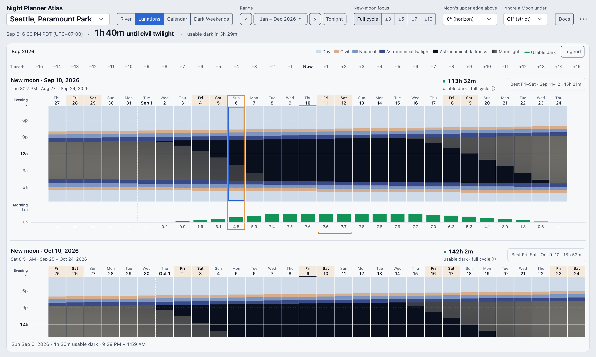

# Night Planner Atlas

Plan dark-sky nights by the month and the year. For any site, Night Planner Atlas shows each
night's twilight stages, when the moon is up, and how much **moon-free true dark** there is. The
layout shows how that shape shifts across weeks, lunar cycles and seasons, so you can pick the
nights worth the drive to a dark site.


It is a private prototype for now; [issues](https://github.com/mikemag/night-planner-atlas/issues)
track where it is going.

## The views

- **River** (default): one row per night, clock time across. The moon's nightly 50-minute
  march becomes diagonal stripes, the seasons an hourglass, and clock changes a visible step.
  Zoom by row height: Year, Month, Week.
- **Calendar**: a month grid where each day holds that evening's night, and a Year view of mini
  months with monthly totals. Expand any week for times.
- **Lunations**: one row per lunar cycle, aligned on new moon, with the best Friday–Saturday of
  each cycle.
- **Table**: the same numbers, one month at a time.

All views share one visual language and the same controls: new-moon focus (±N nights), when the
moon counts as up, and whether to ignore a thin crescent. Click any night for its altitude chart
and stage times; the side panel also lists the darkest weekends ahead.

| Year at a glance (River)                        | Calendar                                           | Lunations                                          |
| ----------------------------------------------- | -------------------------------------------------- | -------------------------------------------------- |
|  |  |  |

- [docs/design.md](docs/design.md): the views, the shared visual language, and the reasoning
  behind them.
- [docs/night-model.md](docs/night-model.md): exactly how each night is computed.

## Running it

You need Node 24.11 (see `.node-version`; `fnm` or `nvm` will pick it up) and npm.

```bash
npm install
npm run dev
```

`npm run dev` serves the site at <http://localhost:5173/> with hot reload. `npm run build` writes
the deployable static site to `dist/`, and `npm run preview` serves that build. Sun and moon
positions are computed in the browser; your site is saved only in the browser's local storage and
never sent anywhere. You can enter an optional elevation above sea level; blank uses sea level.
Elevation adjusts the observer position and idealized refraction, with a level horizon and no
automatic terrain lookup.

| Command               | What it does                                                                      |
| --------------------- | --------------------------------------------------------------------------------- |
| `npm run check`       | Lint, format check, type check, unit tests and build: what CI runs first          |
| `npm test`            | Unit tests for the night model (Vitest)                                           |
| `npm run test:e2e`    | Browser smoke tests of the built site in Chromium and WebKit (Playwright)         |
| `npm run screenshots` | The smoke tests, saving a screenshot of every view to `test-results/screenshots/` |
| `npm run format`      | Format everything with Prettier                                                   |

The first time you run the browser tests, install their browsers with
`npx playwright install chromium webkit`.

## Layout

```text
index.html              the page (Vite entry)
src/
  model/                the night model: time zones, nights, ranges, formatting (no DOM)
  app/                  settings, shared state, and the shell that ties views together
  views/                River, Calendar, Lunations and Table
  render/               canvas surface, theme colors, drawing one night
  ui/                   inspector, tooltip, controls
  styles/atlas.css      theme tokens, layout, components
public/                 files served as-is (favicon)
e2e/                    browser smoke tests
docs/                   design notes, night model, screenshots
AGENTS.md               guidance for coding agents working in this repo
```

## Status

A working prototype with a real toolchain: TypeScript, Vite, unit and browser tests, and CI on
every push and pull request. Work is tracked in GitHub issues. The night model has been checked
against USNO tables; see the measured accuracy and sampling limits in
[the night model](docs/night-model.md#reference-verification-and-accuracy). Next up is polishing
the River, Calendar and Lunations views and assessing usability before hosting and launch.

## Credits

Sun and moon positions come from [Astronomy Engine](https://github.com/cosinekitty/astronomy) by
Don Cross (MIT). See [THIRD_PARTY_NOTICES.md](THIRD_PARTY_NOTICES.md).

## License

Not yet licensed: all rights reserved while the project is private.
