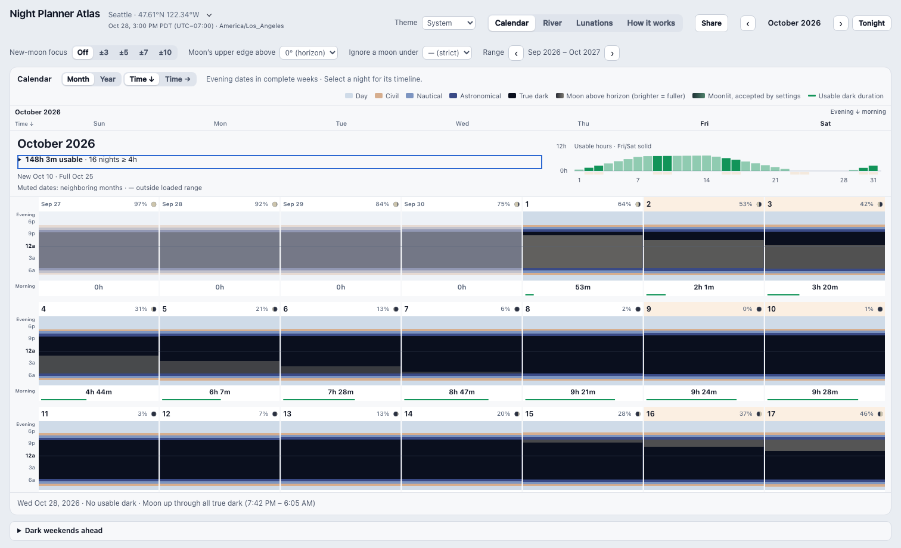
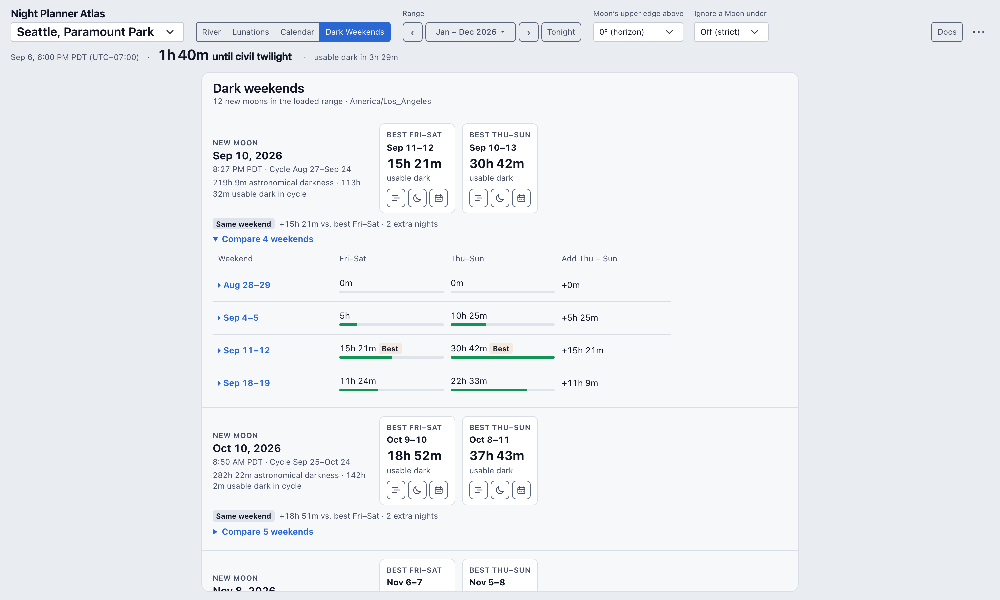

# Night Planner Atlas

Plan dark-sky nights by the month and the year. For any site, Night Planner Atlas shows each
night's twilight stages, when the Moon is up, and how much **usable dark** there is. Usable dark
is the part of astronomical darkness that meets your Moon settings. The views show how these
windows shift across weeks, lunar cycles, and seasons.


[Open Night Planner Atlas](https://night-planner-atlas.web.app/).
[Issues](https://github.com/mikemag/night-planner-atlas/issues) track ongoing work.

## The views

- **River** (default): one row per night, clock time across. The moon's nightly 50-minute
  march becomes diagonal stripes, the seasons an hourglass, and clock changes a visible step.
  Use Year for an overview, Month for nightly windows, and expand individual Month nights for boundary times.
- **Calendar**: a complete month of quiet night summaries, seven detailed nights in Week, or a
  Year of month choosers. Each month cell shows usable hours, its clock window and an inset vertical green
  bar. Scroll through months or weeks; selecting a date inserts the shared timeline after its row.
  Dim neighboring dates complete the weeks.
- **Lunations**: one row per lunar cycle, aligned on new moon, with the best Friday–Saturday of
  each cycle. Full cycle shows every night exactly once, assigned to its nearest new moon, with
  padding keeping new moon centered. Taller night columns run from evening down to morning, with usable-hour bars below;
  select a night for its horizontal timeline. Phones start at ±3 nights, with wider windows available.
- **Dark Weekends**: compare the best Fri–Sat and Thu–Sun trips for each new moon in the range. Expand
  a cycle for the gain from adding Thursday and Sunday to the same weekend and the nightly windows.
  Open a trip's first night in River, Lunations or Calendar.

The **Range** date button sets the dates for all four views. **Around now** shows 14 months
starting with the previous month at the site. **Calendar year** shows January through December
of the chosen year. The arrows shift the range by a year. **Tonight** jumps to the current
observing night and returns to Around now if that night is outside the range.
On phones, **Plan settings** groups Range, new-moon focus and Moon thresholds. The compact
header keeps the site, view tabs, Tonight and live status visible in portrait and landscape.
The next event has a labeled countdown; tap it for **Live details**, including the site's clock,
time zone and usable-dark status. Touch charts omit the desktop hover readout.

**More → Read night** provides a text view with a date picker, Previous/Next night buttons,
usable windows, twilight and Moon events. Times include their dates and, on clock-change nights,
UTC offsets. Keyboard users can skip to the chart or open the selected night's text view;
chart shortcuts work while the chart has focus.

All views share one visual language and Moon settings for when the Moon counts as up and whether
to ignore a thin crescent. The charts also support new-moon focus (±N nights) and share ordered
boundary times and separate usable windows in expanded nights.
Calendar uses familiar Month, Week and Year grids. Month and Year share green duration bars, and
Week labels the boundaries between shaded regions directly. **Docs** is visible in the header,
with a short overview, FAQ, practical guide, worked night examples, detailed calculations,
privacy, and a separate Licenses and credits page. The examples compare strict and relaxed Moon settings without changing the open plan.

<details>
<summary>Calendar · choose dates in a month</summary>



</details>

<details>
<summary>Lunations · compare full lunar cycles</summary>


</details>

<details>
<summary>Dark Weekends · compare two-night and four-night trips</summary>



</details>

<details>
<summary>River Year · see the seasons in Dark theme</summary>


</details>

These examples use the public Seattle starter site and strict Moon settings: 0° and no crescent
exception. Open an image for its full resolution.

## Sites, sharing and offline use

Sun and Moon positions and site time zones are computed in the browser. Choose **Manage sites…**
at the bottom of the site picker to add, edit, duplicate, remove or reorder saved sites. Paste
decimal coordinates or a supported full Google Maps search link to infer an editable IANA zone
with the bundled offline lookup. Optional elevation adjusts the observer position and idealized
refraction, assuming a level horizon; blank uses sea level.

**More → Share site** makes an invitation that opens the location in Around now with the
recipient's settings. It reuses an existing saved site or saves a new one at the top, with Undo.
**Welcome the recipient** adds an introduction for someone receiving a new site.
**Share plan** preserves the selected dates, view and Moon settings, with the option to include
the site. Anyone with a site-bearing link can read its details.

Saved sites and preferences stay in this browser on this device. **More → Browser data** exports
a backup or imports a reviewed replacement of all sites and preferences, including site order.
It also offers one recovery copy from before an import, preference reset or saved-data upgrade;
ordinary site edits do not create history. **More → Export to calendar** downloads a local
`.ics` snapshot of chosen new moons, best Fri–Sat weekends and nights with usable dark.

Open Atlas online and wait for **Ready to reopen offline** in More. The same address can then
reload or open in a new tab in that browser without a connection. System, Light, Dark and
Observing themes are saved locally; Observing is designed for a separately enabled OS red filter.

See the [visitor guide](https://night-planner-atlas.web.app/?docs=using),
[Privacy](https://night-planner-atlas.web.app/?docs=privacy) and
[Licenses and credits](https://night-planner-atlas.web.app/?docs=licenses). Engineering references:

- [docs/design.md](docs/design.md): the views, the shared visual language, and the reasoning
  behind them.
- [docs/night-model.md](docs/night-model.md): exactly how each night is computed.
- [docs/hosting.md](docs/hosting.md): local deployment, caching, rollback and browser storage.
- [docs/time-zone-data.md](docs/time-zone-data.md): offline boundary-data provenance and updates.

## Running it

You need Node 24.11 (see `.node-version`) and npm. With `fnm`, select the installed 24.11 version
using `fnm use` before running the commands below.

```bash
npm ci
npm run dev
```

`npm run dev` serves the site at <http://localhost:5173/> with hot reload. `npm run build` writes
the deployable static site to `dist/`, and `npm run preview` serves that build.

See [Hosting Night Planner Atlas](docs/hosting.md) for local deployment, caching, rollback and
per-browser settings behavior. Firebase serves the built site; the
[GitHub repository](https://github.com/mikemag/night-planner-atlas) provides its AGPL source and
build instructions.

| Command                        | What it does                                                                      |
| ------------------------------ | --------------------------------------------------------------------------------- |
| `npm run check`                | Lint, format check, regular unit tests and build (including the type check)       |
| `npm run check:full`           | Check, exhaustive model audits and all browser tests                              |
| `npm run deploy`               | Run the full gate, then publish to Firebase Hosting                               |
| `npm test`                     | Regular unit tests, including golden records and independent numerical references |
| `npm run test:audit`           | Exhaustive full-year lunar sampling and polar solar audits                        |
| `npm run test:all`             | Both regular unit tests and numerical audits                                      |
| `npm run test:e2e:smoke`       | Small cold-start browser suite: views, selection and site switching               |
| `npm run test:e2e:ui`          | Visual and interaction regressions with prepared calculation data                 |
| `npm run test:e2e:integration` | Cold-start, storage, sharing, offline and computation integration tests           |
| `npm run test:e2e`             | Full browser regression suite (UI and integration)                                |
| `npm run screenshots`          | Curated headless view/theme captures in `test-results/screenshots/`               |
| `npm run screenshots:retina`   | Optional Retina visual checks in a visible WebKit window                          |
| `npm run screenshots:readme`   | Build and capture the five README examples in `test-results/readme/`              |
| `npm run format`               | Format everything with Prettier                                                   |

See [Testing Atlas](docs/testing.md) for browser setup, choosing checks, theme coverage,
screenshots, debugging and timing runs.

## Layout

```text
index.html              the page (Vite entry)
src/
  model/                the night model: time zones, nights, ranges, formatting (no DOM)
  app/                  settings, shared state, and the shell that ties views together
  views/                River, Calendar and Lunations canvas views
  render/               canvas surface, theme colors, drawing one night
  ui/                   Dark Weekends, night details, controls and bundled Docs pages
  styles/atlas.css      theme tokens, layout, components
public/                 favicon, license texts and downloadable time-zone data
e2e/                    browser UI and integration regression tests
scripts/                reproducible README capture
docs/                   design notes, night model, screenshots
AGENTS.md               guidance for coding agents working in this repo
```

## Status

The [planner](https://night-planner-atlas.web.app/) is built with TypeScript and Vite, with local
unit and browser tests. Work is tracked in GitHub issues. The night model has been checked
against USNO tables; see the measured accuracy and sampling limits in
[the night model](docs/night-model.md#reference-verification-and-accuracy).

## Credits

Sun and moon positions come from [Astronomy Engine](https://github.com/cosinekitty/astronomy) by
Don Cross (MIT). Offline time-zone lookup uses tzf-wasm (MIT), with boundary data from
OpenStreetMap contributors via timezone-boundary-builder and tzf-dist (ODbL 1.0).
Bootstrap and Popper provide UI components (MIT). See [THIRD_PARTY_NOTICES.md](THIRD_PARTY_NOTICES.md).

## License

Copyright © 2026 Mike Magruder.

| Material                                                                                                        | Terms                                                                                                |
| --------------------------------------------------------------------------------------------------------------- | ---------------------------------------------------------------------------------------------------- |
| Original application code, HTML/CSS structure, build scripts, configuration and tests                           | [GNU AGPL version 3 only](LICENSE), SPDX `AGPL-3.0-only`                                             |
| Original documentation, explanatory text and illustrations, including the prose and artwork embedded in the app | [CC BY-SA 4.0](public/licenses/cc-by-sa-4.0.txt)                                                     |
| Calculated numerical results, including values shown in charts and exports                                      | [CC0 1.0](public/licenses/cc0-1.0.txt), to the extent the project holds copyright or database rights |

Credit Mike Magruder and Night Planner Atlas when reusing the original content. Keep attribution,
link to the license, indicate changes, and use the same or a compatible license for shared
adaptations. Code examples use the code license. The CC0 dedication covers calculated values;
the surrounding original text and illustrations use the content license. User-entered sites
and personal data are outside these project grants.

Third-party code, data, reference material and license texts retain their own terms and notices.
In particular, the bundled time-zone boundary dataset remains ODbL 1.0. See
[THIRD_PARTY_NOTICES.md](THIRD_PARTY_NOTICES.md).

The app’s Docs navigation includes **Licenses and credits**, with the scope of each grant,
full terms readable offline, and third-party attribution.

The AGPL source is available in
[mikemag/night-planner-atlas](https://github.com/mikemag/night-planner-atlas), including the files
and [build instructions](#running-it) needed to modify and rebuild it. When distributing a
licensed build, provide recipients with the matching corresponding source and build instructions.
