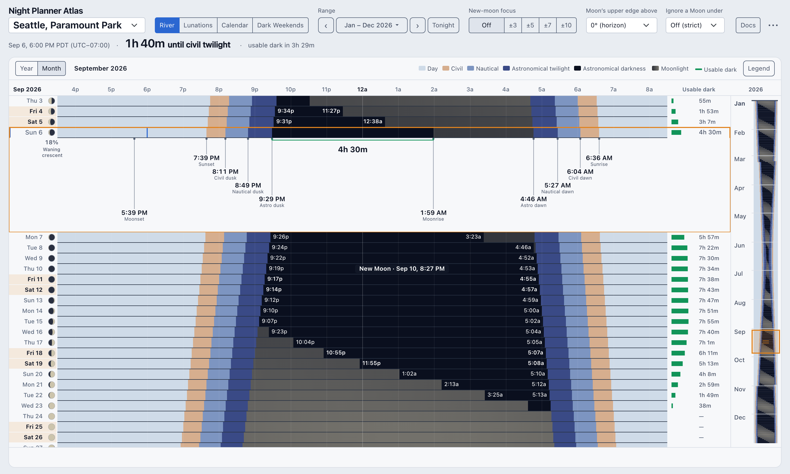
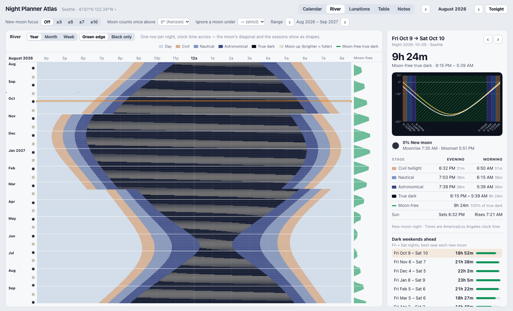

# Night Planner Atlas

Plan dark-sky nights by the month and the year. For any site, Night Planner Atlas shows each
night's twilight stages, when the Moon is up, and how much **usable dark** there is. Usable dark
is the part of astronomical darkness that meets your Moon settings. The views show how these
windows shift across weeks, lunar cycles, and seasons.



It is a private prototype for now; [issues](https://github.com/mikemag/night-planner-atlas/issues)
track where it is going.

## The views

- **River** (default): one row per night, clock time across. The moon's nightly 50-minute
  march becomes diagonal stripes, the seasons an hourglass, and clock changes a visible step.
  Use Year for an overview, Month for nightly windows, and expand individual Month nights for boundary times.
- **Calendar**: a complete month of quiet night summaries, seven detailed nights in Week, or a
  Year of month choosers. Each month cell shows usable hours, its clock window and an inset vertical green
  bar. Scroll through months or weeks; selecting a date inserts the shared timeline after its row.
  Dim neighboring dates complete the weeks.
- **Lunations**: one row per lunar cycle, aligned on new moon, with the best Friday–Saturday of
  each cycle. Full cycle shows every night exactly once, assigned to its nearest new moon, with
  padding keeping new moon centered. Taller night columns run from evening down to morning, with usable-hour bars below;
  select a night for its horizontal timeline. Phones start at ±3 nights, with wider windows available.
- **Dark Weekends**: compare the best Fri–Sat and Thu–Sun trips for each new moon in the range. Expand
  a cycle for the gain from adding Thursday and Sunday to the same weekend and the nightly windows.
  Open a trip's first night in River, Lunations or Calendar.

The **Range** date button sets the dates for all four views. **Around now** shows 14 months
starting with the previous month at the site. **Calendar year** shows January through December
of the chosen year. The arrows shift the range by a year. **Tonight** jumps to the current
observing night and returns to Around now if that night is outside the range.

All views share one visual language and Moon settings for when the Moon counts as up and whether
to ignore a thin crescent. The charts also support new-moon focus (±N nights) and share ordered
boundary times and separate usable windows in expanded nights.
Calendar uses familiar Month, Week and Year grids. Month and Year share green duration bars, and
Week labels the boundaries between shaded regions directly. **Docs** is visible in the header,
with a short overview, FAQ, practical guide, worked night examples, detailed calculations,
privacy, and a separate Licenses and credits page. The examples compare strict and relaxed Moon settings without changing the open plan.

| Year at a glance (River)                        | Calendar                                           | Lunations                                           |
| ----------------------------------------------- | -------------------------------------------------- | --------------------------------------------------- |
|  |  |  |

- [docs/design.md](docs/design.md): the views, the shared visual language, and the reasoning
  behind them.
- [docs/night-model.md](docs/night-model.md): exactly how each night is computed.

## Running it

You need Node 24.11 (see `.node-version`; `fnm` or `nvm` will pick it up) and npm.

```bash
npm install
npm run dev
```

`npm run dev` serves the site at <http://localhost:5173/> with hot reload. `npm run build` writes
the deployable static site to `dist/`, and `npm run preview` serves that build.

Sun and moon positions and site time zones are computed in the browser. Named favorites stay in
browser storage. Paste coordinates or a supported full Google Maps search link to infer an editable
IANA zone with the bundled offline lookup. The header shows the site’s current local clock, UTC
offset and zone. System, Light, Dark and Observing themes are saved locally. Observing is designed
for a separately enabled OS red filter.

**Share site** opens the location in Around now with the recipient’s settings. It reuses a saved
site or saves a new one with Undo. **Share plan** preserves the selected dates, view and Moon
settings, with the option to include the site.

You can enter an optional elevation above sea level; blank uses sea level.
Elevation adjusts the observer position and idealized refraction, with a level horizon and no
automatic terrain lookup.

See [Hosting the Helen preview](docs/hosting.md) for local deployment, caching, rollback and
per-browser settings behavior. Deployment publishes only the built site; the repository stays
private.

| Command               | What it does                                                                      |
| --------------------- | --------------------------------------------------------------------------------- |
| `npm run check`       | Lint, format check, type check, unit tests and build                              |
| `npm run deploy`      | Run local checks and browser tests, then publish to Firebase Hosting              |
| `npm test`            | Unit tests for the night model (Vitest)                                           |
| `npm run test:e2e`    | Browser smoke tests of the built site in Chromium and WebKit (Playwright)         |
| `npm run screenshots` | The smoke tests, saving a screenshot of every view to `test-results/screenshots/` |
| `npm run format`      | Format everything with Prettier                                                   |

The first time you run the browser tests, install their browsers with
`npx playwright install chromium webkit`. All checks run locally; GitHub does not run tests on
pushes or pull requests. Browser tests build and start their own preview server on port 4174 and
fail if that port is already occupied, so they cannot accidentally test a different server.

## Layout

```text
index.html              the page (Vite entry)
src/
  model/                the night model: time zones, nights, ranges, formatting (no DOM)
  app/                  settings, shared state, and the shell that ties views together
  views/                River, Calendar and Lunations
  render/               canvas surface, theme colors, drawing one night
  ui/                   shared night details, readout, controls
  styles/atlas.css      theme tokens, layout, components
public/                 files served as-is (favicon)
e2e/                    browser smoke tests
docs/                   design notes, night model, screenshots
AGENTS.md               guidance for coding agents working in this repo
```

## Status

A working prototype with TypeScript, Vite, and local unit and browser tests.
Work is tracked in GitHub issues. The night model has been checked
against USNO tables; see the measured accuracy and sampling limits in
[the night model](docs/night-model.md#reference-verification-and-accuracy). Next up is polishing
the River, Calendar and Lunations views and assessing usability in the
[hosted preview](https://night-planner-atlas.web.app/). Public launch remains separate work.

## Credits

Sun and moon positions come from [Astronomy Engine](https://github.com/cosinekitty/astronomy) by
Don Cross (MIT). Offline time-zone lookup uses tzf-wasm (MIT), with boundary data from
OpenStreetMap contributors via timezone-boundary-builder and tzf-dist (ODbL 1.0). See [THIRD_PARTY_NOTICES.md](THIRD_PARTY_NOTICES.md).

## License

Copyright © 2026 Mike Magruder.

| Material                                                                                                        | Terms                                                                                                |
| --------------------------------------------------------------------------------------------------------------- | ---------------------------------------------------------------------------------------------------- |
| Original application code, HTML/CSS structure, build scripts, configuration and tests                           | [GNU AGPL version 3 only](LICENSE), SPDX `AGPL-3.0-only`                                             |
| Original documentation, explanatory text and illustrations, including the prose and artwork embedded in the app | [CC BY-SA 4.0](public/licenses/cc-by-sa-4.0.txt)                                                     |
| Calculated numerical results, including values shown in charts and exports                                      | [CC0 1.0](public/licenses/cc0-1.0.txt), to the extent the project holds copyright or database rights |

Credit Mike Magruder and Night Planner Atlas when reusing the original content. Keep attribution,
link to the license, indicate changes, and use the same or a compatible license for shared
adaptations. Code examples use the code license. The CC0 dedication covers calculated values;
the surrounding original text and illustrations use the content license. User-entered sites
and personal data are outside these project grants.

Third-party code, data, reference material and license texts retain their own terms and notices.
In particular, the bundled time-zone boundary dataset remains ODbL 1.0. See
[THIRD_PARTY_NOTICES.md](THIRD_PARTY_NOTICES.md).

The app’s Docs navigation includes **Licenses and credits**, with the scope of each grant,
full terms readable offline, and third-party attribution.

When distributing a licensed build, provide recipients with the matching corresponding source,
including the files and build instructions needed to modify and rebuild it. The repository is
private during the preview, so public access to the matching source must be arranged before
publishing the licensed build. The [running instructions](#running-it) describe the build.
